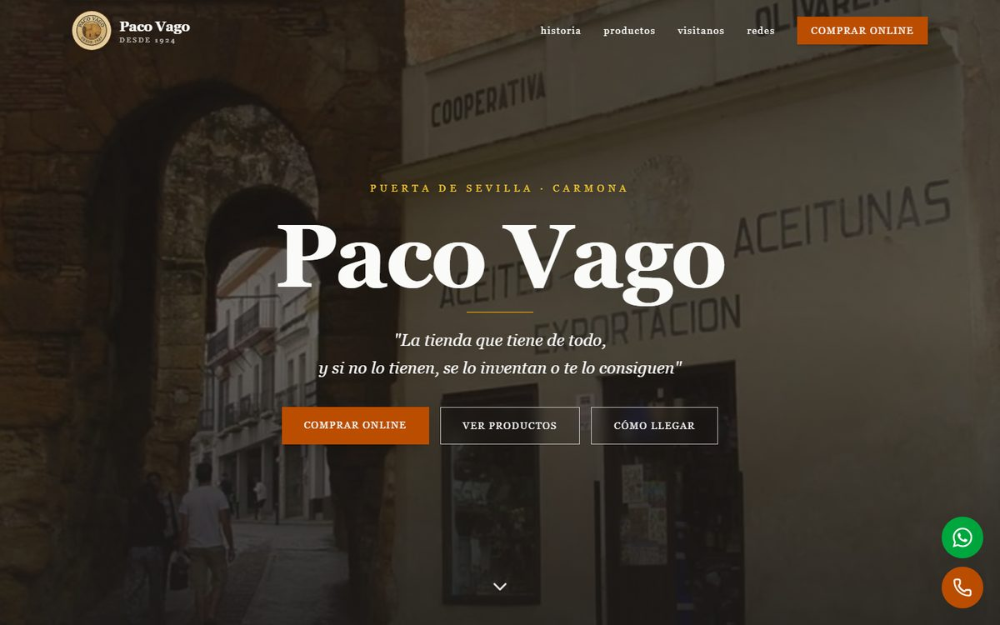
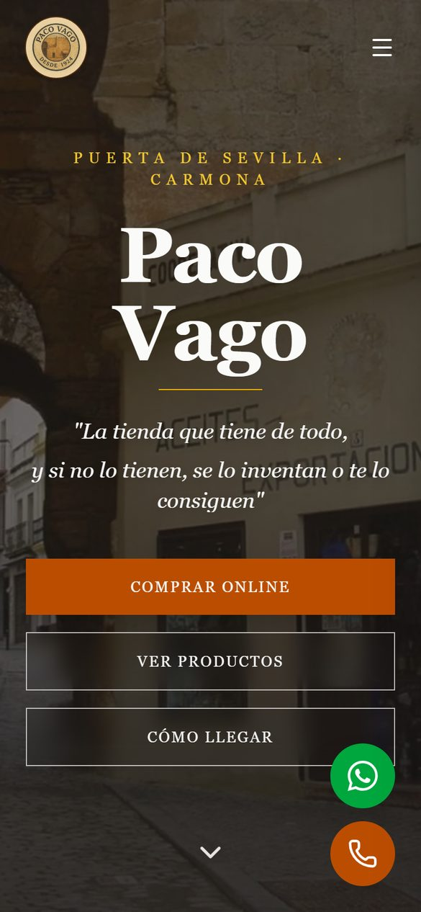

<div align="center">

# Paco Vago

**Web y tienda online de una tienda centenaria (desde 1924) en la Puerta de Sevilla, Carmona.**


**[Ver web](https://pacovago.es)** · https://pacovago.es

</div>

<table>
  <tr>
    <td width="72%"></td>
    <td width="28%"></td>
  </tr>
</table>

## Qué es

Paco Vago es *"la tienda que tiene de todo"*: un comercio familiar abierto en 1924 junto a la
Puerta de Sevilla de Carmona (Sevilla), con productos gourmet, bodega, golosinas, mercería,
moda y piel, perfumería y mucho más. Su local ha servido además de escenario para varios rodajes.

La tienda solo existía en la calle y en redes sociales. Este proyecto le da:

- una **web informativa** con su historia, el local, el catálogo y cómo llegar;
- una **tienda online** con pago con tarjeta;
- un **panel `/admin`** para que el propio dueño suba productos, vea pedidos y atienda
  devoluciones desde el móvil, sin depender de nadie.

## Funcionalidades

**Web pública**
- Portada con historia (1924 → hoy), el local y sus rodajes, catálogo por categorías, galería,
  vídeos de TikTok e Instagram y horario con indicador **Abierto / Cerrado** en tiempo real.
- Botones flotantes de WhatsApp y teléfono; visor de fotos con gestos, flechas y teclado.
- Mapa de Google **solo al pulsar** "Ver mapa": no se conecta con Google sin que el usuario lo pida.

**Tienda online** (`/tienda`)
- Listado con buscador (insensible a acentos), filtros por categoría y enlaces ya filtrados
  (`/tienda?q=…`); ficha de producto con zoom y productos relacionados.
- Carrito persistente, mini-carrito lateral y animación de "volar al carrito".
- **Modelo híbrido:** un producto con precio **y** peso se compra online; si le falta alguno,
  muestra "Me interesa" por WhatsApp. El catálogo crece al ritmo que el dueño da los datos.
- **Portes por tramos de peso**, envío gratis desde 100 € en pedidos de menos de 10 kg y
  **reparto gratis en Carmona** por código postal. Canarias y Baleares, por WhatsApp.
- Pago con **Stripe Checkout** (tarjeta, Apple Pay, Google Pay). La dirección se pide en la
  web y no en Stripe, para que no se pueda saltar la restricción de zona.
- Correo automático al dueño por cada pedido pagado.

**Panel de gestión** (`/admin`)
- Acceso con Supabase Auth; pensado primero para el móvil, con navegación inferior.
- **Productos y categorías:** crear, editar, ocultar, reordenar, precio y peso (aceptan coma) y
  subida de fotos a Supabase Storage.
- **Pedidos:** pestañas por estado, botones de Llamar, WhatsApp y Copiar dirección, y marcar como
  enviado o entregado con opción de **Deshacer**.
- **Devoluciones:** desistimientos recibidos con el plazo de reembolso a la vista.

**Legal**
- Aviso legal, privacidad, condiciones de venta, devoluciones (con modelo de formulario) y
  **desistimiento online** en `/legal/desistir` (Directiva (UE) 2023/2673), con justificante y
  acuse por correo.

## Stack

| Capa | Tecnología |
| --- | --- |
| Interfaz | React 19, React Router 7, Tailwind CSS v4, lucide-react |
| Build | Vite 8 (JavaScript, sin TypeScript) |
| Datos | Supabase: PostgreSQL con RLS, Auth y Storage (con redimensionado de imágenes) |
| Pagos | Stripe Checkout + webhook firmado |
| Servidor | Cloudflare Workers, solo para `/api/*` |
| Correo | Resend, desde el dominio propio |
| Hosting | Cloudflare (estáticos + Worker) · Vercel solo como redirección 301 |

## Arquitectura

```
src/
├── components/
│   ├── layout/      Nav, Footer, IrArriba
│   ├── sections/    Hero, ComprarOnline, Historia, Local, Productos, Galeria, Visitanos, Siguenos
│   ├── pages/       Tienda/, Carrito/, Admin/, Legal/, NoEncontrada/
│   └── ui/          Lightbox, Reveal, FloatingActions, iconos de marca propios
├── data/            categorias.js (fallback), colecciones.js, envios.js, horarios.js, empresa.js
├── hooks/           useCategorias, useCarrito, useAuth, useSeo, useEstadoTienda
├── lib/supabase.js  cliente de Supabase (a prueba de fallos)
└── utils/           imagenes.js, flyToCart.js, formato.js
servidor/            lógica de /api en formato Request → Response
                     (crear-sesion, stripe-webhook, desistimiento, correo, ligero)
worker/index.js      entrada del Worker: reparte /api/*
api/                 envoltorios de una línea (plan B para Vercel)
supabase/            esquema, políticas, storage, pedidos y desistimientos (SQL)
scripts/             sitemap, alta de productos y prueba del webhook
```

**Flujo de datos**

- **Catálogo:** la web arranca con el catálogo estático (`data/categorias.js`) y lo sustituye por
  el de Supabase en cuanto responde. Si Supabase falla o no está configurado, sigue funcionando
  con el estático.
- **Compra:** carrito (navegador) → `POST /api/crear-sesion` → el servidor **relee precios y pesos
  de la base de datos y recalcula los portes**, sin fiarse del carrito → Stripe Checkout → webhook
  firmado → pedido guardado en `pedidos` (idempotente) → correo al dueño.
- **Servidor ligero:** el Worker no usa los SDK de Stripe ni de Supabase; habla con sus API por
  `fetch` y valida la firma del webhook con WebCrypto (tolerancia de 5 min y comparación en tiempo
  constante). Pasó de 1,6 MB a 25 KB y cabe en el límite de CPU del plan gratuito.

## Seguridad

- **RLS en todas las tablas:** catálogo de lectura pública; `pedidos` y `desistimientos` no se
  pueden leer ni escribir con la clave pública. Registro público de usuarios desactivado.
- Las claves secretas (Stripe, `service_role`, Resend) son secretos del Worker; en el navegador
  solo está la clave pública de Supabase.
- Webhook con firma verificada; los avisos repetidos no duplican pedidos ni correos.
- Storage limitado a JPG, PNG y WebP de hasta 10 MB.
- Cabeceras en [`public/_headers`](public/_headers): `X-Frame-Options: DENY`,
  `frame-ancestors 'none'`, `nosniff`, `Referrer-Policy` y `Permissions-Policy`.
- Sin analítica ni contenido de terceros al cargar, así que no necesita banner de cookies.

## SEO y rendimiento

- `useSeo` da a cada ruta su título, descripción, canonical, Open Graph y `robots`; carrito,
  confirmación y panel van con `noindex`.
- Datos estructurados `Store` en la portada y `Product` en cada ficha; la oferta solo se declara
  si el producto se puede comprar de verdad.
- `sitemap.xml` generado desde la base de datos con `npm run sitemap`.
- Imágenes servidas al tamaño en que se muestran (transformación de Supabase): la portada pasó
  de 11 MB a unos 4 MB de fotos. CLS medido: 0.
- Tienda, carrito y panel se cargan de forma diferida, en chunks aparte.

## Accesibilidad

- Áreas pulsables de al menos 44 × 44 px en móvil.
- Texto alternativo en todas las imágenes, jerarquía de títulos correcta y enlaces con nombre
  accesible.
- Las animaciones del panel se desactivan con "reducir movimiento".
- Sin desbordamiento horizontal a 375 px ni a 1440 px.

## Desarrollo local

```bash
npm install
cp .env.example .env   # y rellena los valores
npm run dev            # http://localhost:5173 (solo frontend, sin /api)
```

| Script | Qué hace |
| --- | --- |
| `npm run dev` | Servidor de desarrollo de Vite (solo frontend) |
| `npm run cf` | Compila y arranca el Worker en local (`wrangler dev`, puerto 8787), con `/api` |
| `npm run demo` | Panel `/admin` con un Supabase simulado: sin login real, datos inventados, nada se guarda |
| `npm run build` | Build de producción en `dist/` |
| `npm run preview` | Sirve el build |
| `npm run sitemap` | Regenera `public/sitemap.xml` desde el catálogo |
| `npm run lint` | ESLint |

Variables de entorno (ver [`.env.example`](.env.example)):

- **Navegador** (se incrustan al compilar): `VITE_SUPABASE_URL`, `VITE_SUPABASE_ANON_KEY`.
- **Solo servidor:** `STRIPE_SECRET_KEY`, `STRIPE_WEBHOOK_SECRET`, `SUPABASE_SERVICE_ROLE_KEY`,
  `SITIO_URL` y, en producción, `RESEND_API_KEY`.

Para probar el webhook sin instalar la CLI de Stripe: `node scripts/probar-webhook.js`
(con `DESTINO_WEBHOOK=http://localhost:8787/api/stripe-webhook` si usas `npm run cf`).

La base de datos se crea ejecutando los SQL de [`supabase/`](supabase/) en el SQL Editor:
`schema.sql`, `seed.sql`, `policies-admin.sql`, `storage.sql`, `peso.sql`, `pedidos.sql` y
`desistimientos.sql`.

## Despliegue

- **Producción:** Cloudflare Workers, configurado en [`wrangler.jsonc`](wrangler.jsonc). Los
  estáticos de `dist/` se sirven directamente y solo `/api/*` pasa por el Worker.

  ```bash
  npm run build                              # las VITE_* se fijan al compilar
  npx wrangler deploy
  npx wrangler secret put STRIPE_SECRET_KEY  # y el resto de secretos de servidor
  ```

- **Dominio:** `pacovago.es` y `www.pacovago.es`, como dominios propios del Worker.
- **Vercel:** [`vercel.json`](vercel.json) solo redirige `paco-vago.vercel.app/*` a
  `pacovago.es` con un 301, para conservar enlaces antiguos y posicionamiento.


---

<div align="center">

Hecho por **[Alberto Calero](https://github.com/albertocalerocastillo)**

</div>
